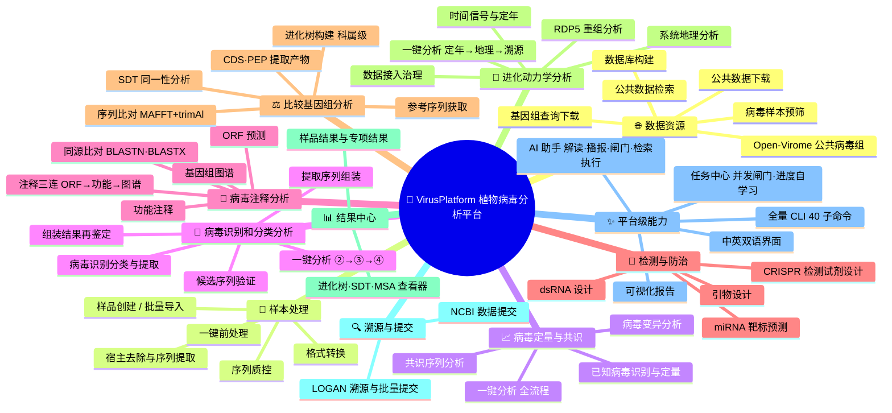

<div align="center">

[English](README_EN.md) · [简体中文](README.md)

# 🌿 VirusPlatform — 植物病毒分析平台

**基于 [kunpeng](https://github.com/afshinokh/kunpeng)（超低内存宏基因组分类器）的 Windows 本地植物病毒诊断与深度分析平台**

从原始 FASTQ 到 NCBI 提交文件，**鼠标点击即可走完全程**：
宿主去除 → 已知病毒识别与定量 → 组装 → ORF 预测与功能注释 → 进化树 / SDT / 分子钟 / 系统地理 → 引物设计 → 基因组图 → 可视化报告 → 公共数据溯源 → NCBI 提交准备


</div>

---

## ✨ 平台一览

- **一条流水线跑到底**：⓪~⑩ 共 15 个阶段（默认分析序 13 步；⓪ 质控与子采样为可选），每步输出自动作为下一步输入，断点续跑、强制重跑、可选步骤自动降级一应俱全。
- **本地优先，离线可用**：所有外部工具（kunpeng / SPAdes / MAFFT / RAxML-NG / DIAMOND / salmon / primer3 …）随平台内置或自动探测；数据库本地建、本地查，下载仅限 NCBI/ENA/NGDC 官方域名白名单。
- **图形界面 + 命令行双入口**：pywebview 桌面窗口或浏览器网页（中英双语一键切换），同一套引擎支撑 `main.py` 全量 CLI，可脚本化批处理。
- **进化分析不止于建树**：内置 TreeTime 最大似然分子钟、离散性状地理重构（mugration）、天际线、RTT/DRT 回归、BSP、BEAST 交接与 Markov-jump 解析、系统地理迁移动画（GIF）——植物病毒流行病学一站式完成。
- **越用越聪明**：每阶段历史耗时自学习，任务卡实时显示全局进度与预计剩余时间；重任务并发闸门、磁盘水位横幅、资源预估日志齐备。
- **AI 助手（对话驱动智能代理）**：总览页常驻对话坞，对分析结果做解读、答当前任务状态、给下一步建议——AI 只读落盘产物（顾问层），关键数字由代码从结果文件算出注入，不由模型编造；OpenAI 兼容端点通吃 DeepSeek / GLM / 通义 / Kimi / OpenAI，选本地 Ollama 可完全离线；默认只发送统计摘要与表格行，不发送序列本体。并有主动驱动三层：**阶段讲解**（静态知识库，零消耗）→ **结果播报**（关键节点自动解读推送）→ **决策闸门**（关键阶段收尾后 AI 评估并等确认，默认关闭）。AI 能真正**驱动找数据**：对话里说"查某物种的转录组/基因组数据"，AI 直接检索 SRA+GSA（复用公共数据检索引擎，完成后自动播报），再以执行单把选中的 run 下载进平台——能力感知来自平台模块清单，不再把用户推去外部数据库。执行权三级分级放开：**执行单**（AI 起草、人批准，参数 diff 可见）→ **自动重试**（失败后原参数重跑 1 次，默认关）→ **自动调参闭环**（限定键边界内提参自动重跑，需手动开启）；删除类/全局重置类动作永不进入白名单。
- **研究闭环**：公共数据检索（NCBI SRA + NGDC GSA）→ 批量下载 → 分析 → LOGAN 全量 SRA 溯源 → NCBI GenBank/BioSample 提交准备，全链路不出平台。

## 🧭 分析工作流


## 🗺️ 功能全景

> 平台内使用手册顶部有**可交互版功能树**（点击展开、直达对应工具卡）；`docs/功能全景图.html` 为可独立打开的全景页。



## 📦 功能模块总览

> 每个模块的**详细说明（输入输出 · 参数 · CLI · 产物目录 · 注意事项）见 [Wiki](https://github.com/zhangwenda0518/VirusPlatform/wiki)**。

### 主分析管道（样品级，⓪ → ⑩）

| 阶段 | Wiki | 引擎 | 输出 |
|---|---|---|---|
| ⓪ Fastp 质控（可选） | [Preprocess](https://github.com/zhangwenda0518/VirusPlatform/wiki/Preprocess) | fastp | clean reads、质控报告 |
| ⓪b FASTQ→FASTA（可选） | 同上 | seqkit fq2fa | conv_R1/R2.fa.gz（分类提速） |
| ① 宿主去除 | 同上 | kunpeng（宿主库） | kept_R1/R2、宿主占比 |
| ②b 已知病毒识别与定量 | [Kvsuite](https://github.com/zhangwenda0518/VirusPlatform/wiki/Kvsuite) | salmon（EM 定量）/ minibwa | 鉴定表、定量表、BAM+深度、病毒 reads |
| ③ 组装与分类 | [Assembly](https://github.com/zhangwenda0518/VirusPlatform/wiki/Assembly) | SPAdes metaviral/rna + BLAST | contigs、病毒 contig 注释表 |
| ③b 候选序列验证 | 同上 | 宿主筛选→长度分流→blastx/BFVD/类病毒 | 验证通过的候选集 |
| ③c 共识序列与变异 | 同上 | reads 回贴参考 → 逐位置计数 | 共识序列、变异表 |
| ④ 宿主预测 | [Host-Prediction](https://github.com/zhangwenda0518/VirusPlatform/wiki/Host-Prediction) | kunpeng + ICTV 宿主概率级联 | host_prediction.tsv、桑基/旭日图 |
| ⑥ ORF 预测 | [ORF](https://github.com/zhangwenda0518/VirusPlatform/wiki/ORF) | pyrodigal + pyrodigal-rv | faa/ffn/gff |
| ⑥b ORF 功能注释 | 同上 | DIAMOND/MMseqs2/blastp × RefSeq 病毒蛋白 + Pfam HMM + BFVD 病毒域 | orf_annotation.tsv、GFF3、功能示意图 |
| ⑦ 进化树与 SDT | [Phylo](https://github.com/zhangwenda0518/VirusPlatform/wiki/Phylo) | MAFFT + trimAl + FastTree/RAxML-NG/NJ；SDT 精确引擎 | tree.nwk、identity 矩阵+热图 |
| ⑧ 引物设计 | [Primer](https://github.com/zhangwenda0518/VirusPlatform/wiki/Primer) | primer3（保守区/全长）+ 热力学评分 | primers.tsv |
| ⑨ 基因组图 | [Genome-Plots](https://github.com/zhangwenda0518/VirusPlatform/wiki/Genome-Plots) | gbdraw / dna_features_viewer | 圈图 + 线图 SVG |
| ⑩ 可视化报告 | [Report](https://github.com/zhangwenda0518/VirusPlatform/wiki/Report) | plotly + pycirclize + matplotlib | report.html |

### 扩展分析（专项页签）

| 模块 | Wiki | 说明 |
|---|---|---|
| 进化动力学工具组 | [Phylodynamics](https://github.com/zhangwenda0518/VirusPlatform/wiki/Phylodynamics) | TreeTime ML 分子钟/地理重构/天际线/祖先序列、RTT·DRT 回归、BSP、MCC 树解析、时空降采样、元数据治理、比对 QC |
| BEAST 接口 | [BEAST](https://github.com/zhangwenda0518/VirusPlatform/wiki/BEAST) | 服务器 BEAST 作业包生成/回读核验、Markov-jump XML 注入与日志解析、MCC 状态解析 |
| 系统地理 | [Phylogeography](https://github.com/zhangwenda0518/VirusPlatform/wiki/Phylogeography) | 时间/地理元数据驱动的迁移重构 + 迁移弧线动画 GIF；RDP5 重组分析；重组前序列预筛 |
| 公共数据检索与下载 | [Public-Data](https://github.com/zhangwenda0518/VirusPlatform/wiki/Public-Data) | SRA+GSA 双引擎检索、统一元数据 Core14/Full、SCI 级元数据图组、aria2c 批量下载 + 内置 sracha 转 FASTQ、宿主基因组三源下载（NCBI taxon / accession·染色体过滤 / gget·Ensembl Plants）、NCBI datasets CLI 全模式封装（genome/gene/taxonomy/virus+宿主过滤，virus 直通建库）|
| 专项工具箱 | [Toolbox](https://github.com/zhangwenda0518/VirusPlatform/wiki/Toolbox) | dsRNA 全链路设计（选窗→效价→脱靶→引物）、miRNA 靶标预测（5 引擎）、NCBI 参考下载、GenBank 集合与 CDS/PEP 提取、MSA 查看、contig 深度注释、单步工具 |
| NCBI 提交准备 | [Submission](https://github.com/zhangwenda0518/VirusPlatform/wiki/NCBI-Submission) | unified_metadata.csv 一表驱动：在线编辑→校验→生成 source.src / miuvig / assembly / BioSample / template.sbt / 提交报告 |
| LOGAN 溯源 | [Logan](https://github.com/zhangwenda0518/VirusPlatform/wiki/Logan) | 病毒 contig 提交 Logan-Search（覆盖 ~2340 万公开 SRA 样本），批量提交 + SSE 实时进度 + 溯源报告 |

### 平台设施

| 模块 | Wiki | 说明 |
|---|---|---|
| 数据库与参考库 | [Databases](https://github.com/zhangwenda0518/VirusPlatform/wiki/Databases) | Taxonomy、kunpeng 分类库、病毒参考/鉴定库、注释库（RefSeq 蛋白/Pfam）、建树库（plant_tree.db / ictv VMR）、宿主概率表、宿主库构建 |
| 分析流程编排 | [Pipeline](https://github.com/zhangwenda0518/VirusPlatform/wiki/Pipeline-Overview) | 依赖调度、断点续跑、加权进度与剩余时间自学习、资源预估、并发闸门 |
| 设置·任务中心·运维 | [Settings-Ops](https://github.com/zhangwenda0518/VirusPlatform/wiki/Settings-Ops) | 中英双语、19 项默认参数、磁盘水位、环境自检、tool_runs 归档清理、数据库迁移 |
| CLI 完整参考 | [CLI-Reference](https://github.com/zhangwenda0518/VirusPlatform/wiki/CLI-Reference) | 40 个子命令全参数速查 |
| FAQ 与已知事项 | [FAQ](https://github.com/zhangwenda0518/VirusPlatform/wiki/FAQ) | 常见问题、中文路径兼容、大基因组建库、设计说明 |

## 🚀 快速开始

### 1. 安装

```bat
git clone https://github.com/zhangwenda0518/VirusPlatform.git
cd VirusPlatform
python -m pip install -r requirements.txt   :: 装依赖（2026-10-11 起不再随仓库分发，省 ~700MB 克隆体积）
:: 没装 Python 的机器：跳过第 3 行，直接双击「环境自检.bat」——
:: 它会用内置解释器（3rd/python/）检测缺包并自动安装（清华镜像）
```

- 需要 **Windows 10+ 与 Python 3.12+**；**平台以源码形态发布（2026-10-11 定案），欢迎按需修改定制**。外部工具已预置在 `3rd/`（约 1.2GB：单文件工具 + 工具套件 + 内置 Python 解释器），克隆即用，**无需也不支持自行编译**（2026-10-11 起不再提供源码构建路线，历史实测记录见 `docs/归档记录_源码构建路线_20261011.md`）。
- 基因组图首选 gbdraw：`pip install git+https://github.com/satoshikawato/gbdraw.git`（未装自动回退纯 Python 引擎 dna_features_viewer）。
- 仅一个文件超过 GitHub 单文件 100MB 硬限制、改经 [Release（external-tools）](https://github.com/zhangwenda0518/VirusPlatform/releases/tag/external-tools) 分发，下载后放回对应路径即可：
  `3rd/tools/rdp5/3seqTable`（105MB）。Python 依赖一律 pip 安装（2026-10-11 起，含曾经的 `_polars_runtime.pyd` 168MB，均不再需要手动下载）。
- 数据库（约 3.4GB）不进 git：从已有部署机器整体拷贝 `databases/`（跨盘用 `python main.py db-migrate --to D:\库目录`），预置库明细与自建方式见 [Wiki · Databases](https://github.com/zhangwenda0518/VirusPlatform/wiki/Databases)。

### 2. 启动（两种模式）

| 模式 | 命令 | 说明 |
|---|---|---|
| 独立桌面窗口 | `python app.py --gui` | pywebview/WebView2 壳住本地页面，无地址栏 |
| 网页模式 | `python app.py --web` | 默认浏览器打开，可复制地址到其他设备浏览器 |
| 默认（auto） | `python app.py` | 优先桌面窗口，失败自动回退浏览器 |

端口从 8765 起自动顺延探测，**以控制台打印的地址为准**；只监听 `127.0.0.1`，不对外网开放。

### 3. 首次配置（仅一次）

1. **数据库页** → 下载 NCBI Taxonomy（~57MB）；
2. **数据库页** → 选宿主基因组 FASTA + 宿主 TaxID（如 4081 番茄）→ 构建宿主库（病毒库平台已预置，无需构建）；
3. **设置页** → 线程数、邮箱、19 项分析默认参数按需调整（默认即可用）。

### 4. 跑第一个样品

**分析流程页** → 新建样品（填名称、选 R1/R2）→ ▶ 依次运行剩余步骤。
首次建议把「子采样」设为 100000 对 reads，先快速验证全流程。

命令行等价：

```bat
python main.py selfcheck                                   :: 环境自检
python main.py init-taxonomy                               :: 下载 taxonomy
python main.py build-host-db --genome host-db\genome.fa --taxid 4081
python main.py analyze --r1 R1.fastq.gz --r2 R2.fastq.gz --sample NX-5
python main.py report --sample NX-5                        :: 重新生成报告
```

## 🧰 外部工具

`3rd/` 预编译树随仓库分发、克隆即用（2026-10-11 定案：**不再提供源码构建路线**，
历史实测见 `docs/归档记录_源码构建路线_20261011.md`）。需要替换个别工具时，
把新版放进 `3rd/` 对应路径即被自动探测，放别处则在 `platform.json` 的 `tools`
段登记（保存即生效）；`python main.py tools` 看探测状态，`python main.py
selfcheck` 全量体检。缺哪个工具只影响对应步骤——可选步骤（fastp / fq2fa /
gbdraw）自动灰显跳过，必需步骤会明确报缺哪件。

## 🖥️ 界面导览

顶部导航即工作流顺序（🌐 中英一键切换，任务中心带运行中角标）：

**总览**（封面 + 数据库状态 + 工作流入口）· **分析流程**（⓪~⑩ 15 阶段级联卡片）· **结果中心**（报告/专项结果/SDT·MSA·树查看器）· **专项分析**（单步工具 + 参考数据）· **数据下载**（SRR/CRR/URL 批量）· **公共数据检索** · **数据库**（Taxonomy/宿主库）· **公共病毒组** · **LOGAN 溯源** · **提交准备** · **任务中心** · **设置** · **手册**

亮点：
- 每个任务结束自动展开**结果预览面板**（关键数字 + 产物清单 + 打开报告），后台时发系统通知；
- 9 个阶段卡片带「📊 查看」——表格就地弹窗、HTML 报告新窗口；
- 存储与磁盘页：剩余容量条 + 按子库拆分的占用明细，剩余 <20GB 全站黄色水位横幅；
- 并发闸门：重任务 ≤2、轻任务 ≤4，超出自动排队并在任务卡显示排队数。

## 📁 目录结构

```
VirusPlatform/
├─ app.py                    Web GUI 服务（仅监听本机）
├─ main.py                   CLI 入口（40 个子命令）
├─ Virus_Platform_Core/      核心 pipeline 包（GUI 与 CLI 共用，130+ 模块）
│  ├─ web/                   Flask 蓝图（页面/API/任务）
│  ├─ known_virus_suite/     ②b 已知病毒识别与定量引擎
│  ├─ ncbi_submit/           NCBI 提交准备引擎
│  ├─ public_meta/           公共数据检索引擎
│  └─ mirna_target/          miRNA 靶标预测引擎（5 引擎）
├─ webapp/                   页面模板与静态资源（i18n 双语）
├─ tests/                    自检/造数/集成测试（pytest 风格）
├─ dev_tools/                建库与运维脚本（build_virus_db.py / package.py 等）
├─ docs/                     开发文档与模块功能清单
├─ wiki/                     本仓库 Wiki 的源 Markdown（与线上 Wiki 同步）
├─ examples/                 内置示例数据（✨示例按钮共用，~9MB）
├─ 3rd/                      外部依赖（bin/ tools/ python/ open-virome/；python/ 仅
│                            解释器本体入库，依赖包经 requirements.lock 安装；
│                            仅 3seqTable 一个 >100MB 文件经 Release 分发）
├─ databases/                病毒分类/参考/注释/建树库（~3.4GB，不进 git）
├─ host-db/                  宿主基因组与宿主分类库（按物种一库）
├─ platform.json             工具路径/语言/默认参数配置
└─ run/                      运行期数据（results/logs/tasks/…，可重建）
```

旧路径兼容：`tool_runs/`、`results/` 等平台相对路径自动重定向到 `run/` 下；`tools/`、`bin/` → `3rd/`，历史调用无需修改。

## 📤 分发形态（2026-10-11 定案）

**不再打包分发**（`VirusPlatform.exe` 安装包路线停用）：本仓库源码即唯一发布形态——克隆、阅读、修改、定制都在源码上完成，也更契合智能体（AI agent）驱动的工作方式。

- 数据库迁移照旧支持：`python main.py db-migrate --to D:\库目录`（robocopy + 字节校验后才切配置），或「设置 → 数据库目录」直接填路径；
- `dev_tools/package.py` 保留在仓库里，供有自分发需求的用户自行使用，平台官方不再产出安装包。

## 📚 文档

- **[Wiki 首页](https://github.com/zhangwenda0518/VirusPlatform/wiki)** — 25 个页面逐模块详解（快速开始 / 各阶段 / 进化动力学 / BEAST / 系统地理 / 公共数据 / 工具箱 / 提交 / LOGAN / 数据库 / CLI / FAQ）。
- Wiki 源文件同步维护在本仓库 [`wiki/`](wiki/) 目录。
- 开发踩坑记录见 [`docs/DEVELOPMENT_NOTES.md`](docs/DEVELOPMENT_NOTES.md)。

## ❓ FAQ（速览）

<details>
<summary><b>页面报 "Failed to fetch" / 点击无反应？</b></summary>

服务进程退出了——黑色控制台窗口被关闭等于退出平台；或浏览器停在已关闭实例的旧标签页；或大任务占满内存暂时无响应。新版页面失联时自动显示红色诊断横幅，恢复后自动消失。
</details>

<details>
<summary><b>支持哪些输入格式？</b></summary>

FASTQ / FASTQ.gz（双端选 R1/R2，单端只选 R1）；FASTA / FASTA.gz；GenBank .gb/.gbk（基因组图与参考集合）。.zip/.rar/.tar 请先解压。
</details>

<details>
<summary><b>SPAdes / BLAST 报错（中文路径）？</b></summary>

平台已自动处理：SPAdes 经 `%TEMP%\vp_spades`（纯 ASCII）中转，BLAST 库建在 `%TEMP%\vp_blast`。
</details>

<details>
<summary><b>宿主库构建在大基因组上失败？</b></summary>

已修复：建库时序列自动切成 ≤1MB 片段（相邻重叠 34bp 保留跨切口 k-mer），2GB 内存即可完成 1.8GB 基因组建库，k-mer 数与整条建库完全一致。
</details>

更多见 [Wiki FAQ](https://github.com/zhangwenda0518/VirusPlatform/wiki/FAQ)。

## 🙏 引用与致谢

平台整合了大量优秀的开源工具与数据资源，包括（不限于）：

- **kunpeng** — 超低内存宏基因组分类器（宿主去除 / 病毒分类核心）
- **SPAdes**（metaviral/rna）、**salmon**、**minibwa**、**fastp**、**seqkit**、**crabz**
- **pyrodigal / pyrodigal-rv / orfipy**（ORF 预测）、**DIAMOND / MMseqs2 / BLAST+**（同源搜索）
- **pyhmmer × Pfam**、NCBI **RefSeq Viral**（蛋白库）、**BFVD** 病毒域库（与 NCBI 提交链 suvtk 同库同命名）。（原 NCBI CDD 结构域注释因本地库 prefilter 索引 ~5GB 在小内存机器反复 OOM，2026-09-29 起由 BFVD 顶替）
- **MAFFT / trimAl / Gblocks / FastTree / RAxML-NG / IQ-TREE 3**（进化）、**TreeTime**（分子钟）
- **BEAST 1.x**（Markov jump 计数口径，本地不做 MCMC）、**Logan-Search**（Chikhi et al. 2025, bioRxiv 10.1101/2024.07.30.605881）
- **ICTV VMR / MSL**（分类元数据）、NCBI **Taxonomy / SRA / GenBank / BioSample**、NGDC **GSA**
- **primer3**（引物）、**gbdraw / dna_features_viewer**（基因组图）、**plotly / pycirclize / matplotlib**（可视化）
- **Logan-Search**、**RDP5**（重组分析）、**sracha**（GSA .sra 转换，纯 Rust）
- 方法学对齐：VirPhyKit（Yin et al., 2025, Ecol Evol；代码自研，仅对齐输入/输出契约）、MMPV-RNA 管线（宿主预测 C9 级联 / SDT 口径 / 提交准备）
